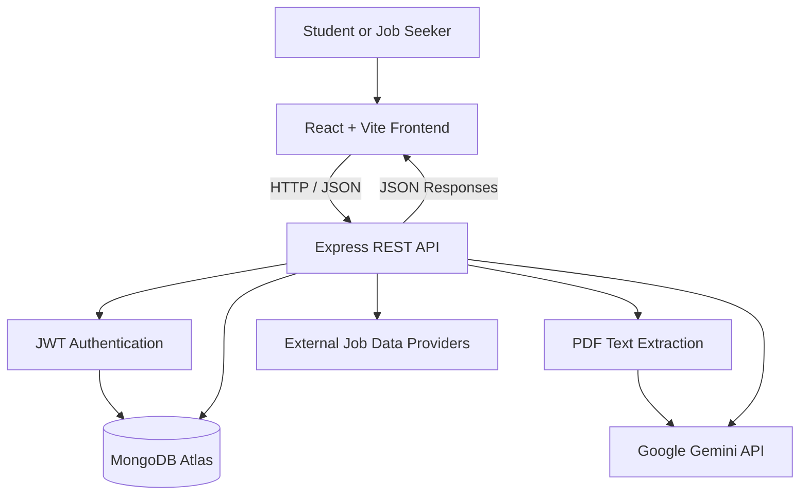

# Career Pilot AI

### AI-Powered Career Development and Internship Management Platform

**Career Pilot AI** is a full-stack web application designed to help students and early-career professionals manage their internship search and application journey in one place. It combines resume analysis, internship discovery, job matching, AI-assisted application preparation, skill development roadmaps, and application tracking into a unified workflow.

The project demonstrates practical full-stack engineering, REST API integration, authentication, database persistence, third-party job data integration, and generative AI integration.

<p align="center">
  <a href="https://career-ai-indol-delta.vercel.app/"><strong>Live Application</strong></a> •
  <a href="https://github.com/Darshan043/CareerAI"><strong>Source Code</strong></a>
</p>

---

## Table of Contents

- [Overview](#overview)
- [Problem Statement](#problem-statement)
- [Key Features](#key-features)
- [Application Workflow](#application-workflow)
- [Technology Stack](#technology-stack)
- [System Architecture](#system-architecture)
- [Project Structure](#project-structure)
- [Getting Started](#getting-started)
- [Environment Configuration](#environment-configuration)
- [API and Backend Design](#api-and-backend-design)
- [Security and Reliability](#security-and-reliability)
- [Testing and Quality Assurance](#testing-and-quality-assurance)
- [Deployment](#deployment)
- [Current Scope and Limitations](#current-scope-and-limitations)
- [Future Enhancements](#future-enhancements)
- [Author](#author)

---

## Overview

The internship search process often involves multiple disconnected tools for resume preparation, opportunity discovery, application management, and skill development. Career Pilot AI aims to bring these activities together through a single, student-focused platform.

Users can maintain a career profile, upload a resume for analysis, discover relevant internship opportunities, evaluate their fit for a role, prepare application materials, and track their progress through different application stages.

The application uses a React-based frontend, a Node.js and Express backend, MongoDB for persistent data, and a Google Gemini integration for supported AI-powered workflows.

**Project type:** Full-Stack Web Application | Generative AI Integration | Career Technology

## Problem Statement

Students and fresh graduates frequently face challenges such as:

- Identifying internships that align with their skills and career goals.
- Understanding strengths and skill gaps in their resumes.
- Evaluating how closely their profile matches a job opportunity.
- Preparing role-specific application materials.
- Organizing application statuses and follow-ups.
- Identifying the skills and projects they should work on next.

Career Pilot AI addresses these challenges by connecting career-profile management, internship discovery, AI-assisted preparation, and application tracking in one application.

## Key Features

### 1. User Authentication and Profile Management

- User registration and login.
- JWT-based authentication for protected API routes.
- User-specific profile and application data.
- Career preferences that help personalize internship discovery.

### 2. AI-Powered Resume Analysis

- Upload a PDF resume through the application.
- Extract text from the uploaded document.
- Analyze resume information through the configured AI workflow.
- Identify skills, strengths, weaknesses, missing skills, and improvement suggestions.
- Use the analysis to support career-profile and opportunity-matching workflows.

### 3. Internship Discovery

- Search for internship opportunities based on target roles and preferences.
- Integrate external job data providers, including JSearch and supported alternative sources.
- Support role-based discovery and location-aware filtering for India.
- Display source information and relevant listing or application links.
- Filter duplicate, stale, and unsuitable listings.
- Load additional results through bounded pagination.

Availability and application links depend on the external providers and the individual job listing.

### 4. Personalized Job Matching

- Compare resume-related skills with internship requirements.
- Calculate a heuristic fit score using skill overlap, role relevance, and location or work-mode alignment.
- Present matching information to help users evaluate opportunities.
- Support more informed internship prioritization.

**Important:** A match score is an application-defined relevance estimate, not a hiring probability, an employer assessment, or a guarantee of selection.

### 5. AI-Assisted Application Preparation

- Generate role-specific application content using the available AI workflow.
- Prepare tailored resume-bullet suggestions.
- Generate cover-letter drafts and application-answer drafts.
- Keep generated content editable before the user chooses to use it.

The platform assists with preparation; it does not automatically submit job applications on the user's behalf.

### 6. Personalized Skill Development Roadmap

- Identify skills that may need improvement for a target opportunity.
- Generate a structured learning roadmap through the configured AI workflow.
- Organize learning recommendations around practical development goals.
- Support progress tracking through the existing application data model.

The usefulness and availability of generated recommendations depend on the input profile, job information, and AI service configuration.

### 7. Internship Application Tracker

- Organize opportunities through application stages:
  - Saved
  - Preparing
  - Applied
  - Interview
  - Offer
  - Rejected
- Maintain application statuses and notes through the backend.
- Keep application-management data associated with the authenticated user.
- Help users review their application pipeline.

### 8. Dashboard and Analytics

- Bring career and application information together in a dashboard.
- Provide access to internship discovery, profile management, tracking, and analytics.
- Help users review their application progress and career-development activity.

---

## Application Workflow

1. **Create an account:** Register and sign in to access personalized functionality.
2. **Build a career profile:** Maintain profile information and career preferences.
3. **Upload a resume:** Submit a PDF resume for text extraction and supported AI analysis.
4. **Discover opportunities:** Search for internships relevant to the user's target role and location.
5. **Evaluate matches:** Review fit information and identify relevant opportunities.
6. **Prepare applications:** Generate and edit role-specific application materials.
7. **Track progress:** Update application stages and maintain notes.
8. **Improve skills:** Use skill-gap insights and learning-roadmap recommendations to guide preparation.

---

## Technology Stack

| Layer | Technologies |
|---|---|
| Frontend | React, JavaScript, Vite |
| Styling | Tailwind CSS |
| Client-side routing | React Router |
| API communication | Axios |
| Client state and data management | Zustand, TanStack Query |
| Form management | React Hook Form |
| Backend | Node.js, Express.js |
| Database and persistence | MongoDB, Mongoose |
| Authentication | JSON Web Tokens (JWT), bcryptjs |
| AI integration | Google Gemini API |
| Document processing | PDF text extraction using `pdf-parse` |
| External opportunity data | JSearch and supported job-data providers |
| Testing | Node.js test runner and automated project tests |
| Frontend deployment | Vercel |
| Backend deployment | Render |
| Database hosting | MongoDB Atlas |

---

## System Architecture

Career Pilot AI follows a client-server architecture.



### Architectural Responsibilities

**Frontend**
- Provides the user interface for profile management, resume upload, internship exploration, application tracking, and analytics.
- Communicates with backend endpoints through a shared API client.
- Manages client-side navigation and application state.

**Backend**
- Exposes REST API endpoints using Express.
- Validates requests and protects authenticated routes.
- Coordinates document processing, AI workflows, job-provider integrations, and persistence.
- Handles errors and returns appropriate API responses.

**Database**
- Uses MongoDB with Mongoose for application persistence.
- Stores user-related information and application data according to the implemented data models.

**AI and External Integrations**
- Connects to Google Gemini for supported generative AI workflows.
- Integrates external job-data providers for internship discovery.
- Processes provider responses before presenting relevant opportunities to users.

---

## Project Structure

```text
CareerAI/
├── client/
│   ├── src/
│   │   ├── components/
│   │   ├── pages/
│   │   ├── api/
│   │   └── ...
│   ├── test/
│   ├── public/
│   ├── package.json
│   ├── vercel.json
│   └── vite.config.js
│
├── server/
│   ├── src/
│   │   ├── agents/
│   │   ├── config/
│   │   ├── controllers/
│   │   ├── middleware/
│   │   ├── models/
│   │   ├── routes/
│   │   ├── services/
│   │   ├── utils/
│   │   └── server.js
│   ├── test/
│   ├── .env.example
│   └── package.json
│
├── spec.md
├── .gitignore
└── README.md
```

*The tree is a high-level guide. Refer to the repository for the exact files and directory contents.*

---

## Getting Started

Follow these steps to run the application locally.

### Prerequisites

Install the following tools and services:

- [Node.js](https://nodejs.org/) and npm
- [Git](https://git-scm.com/)
- A MongoDB database, such as [MongoDB Atlas](https://www.mongodb.com/atlas)
- A Google Gemini API key for AI-powered functionality
- API credentials for any external job provider that requires them

### 1. Clone the Repository

```bash
git clone https://github.com/Darshan043/CareerAI.git
cd CareerAI
```

### 2. Configure the Backend

```bash
cd server
npm install
```

Create a `.env` file inside the `server/` directory using `server/.env.example` as the template.

Configure the required environment variables before starting the backend.

### 3. Start the Backend

```bash
npm run dev
```

The backend development server uses the port configured in the environment settings. Check the server output for the actual listening address and database connection status.

### 4. Configure and Start the Frontend

Open a second terminal from the repository root:

```bash
cd client
npm install
npm run dev
```

Open the local development URL printed by Vite in your terminal.

### 5. Build the Frontend for Production

From the `client/` directory:

```bash
npm run build
```

Vite generates the production build in the `dist/` directory.

### 6. Run Backend Tests

From the `server/` directory:

```bash
npm test
```

To run the configured backend lint checks:

```bash
npm run lint
```

---

## Environment Configuration

Keep backend credentials in `server/.env` for local development. Use your hosting provider's environment-variable settings for production.

The exact required variables are defined in `server/.env.example` and the application's environment configuration.

| Variable | Purpose |
|---|---|
| `PORT` | Backend listening port, if configured |
| `MONGODB_URI` | MongoDB connection URI, including the intended database name |
| `JWT_SECRET` | Secret used for signing and validating authentication tokens |
| `GEMINI_API_KEY` | Server-side Google Gemini API credential |
| `GEMINI_MODEL` | Gemini model identifier |
| `CLIENT_URL` | Primary permitted frontend origin |
| `CLIENT_URLS` | Additional permitted frontend origins, separated by commas |
| `VITE_API_URL` | Frontend build-time backend API base URL |

Check the example environment file and source configuration for the complete requirements and defaults.

### Security Notes

- Never commit `.env` files, database credentials, JWT secrets, or API keys.
- Do not expose `GEMINI_API_KEY` in frontend code or browser requests.
- Use a strong, unique JWT secret.
- Configure production frontend origins explicitly.
- Ensure the MongoDB URI points to the intended application database.
- Do not publish real user resumes or personal information in screenshots, logs, or test fixtures.

---

## API and Backend Design

The backend organizes functionality through Express routes, controllers, services, and supporting modules.

The documented application workflows include:

| API area | Responsibility |
|---|---|
| Authentication | Registration, login, and protected identity |
| Profile | Career profile management and resume upload |
| Internship | Opportunity search and internship details |
| Matching | Resume-to-opportunity relevance information |
| Skill gaps | Personalized learning recommendations |
| Application materials | Resume suggestions, cover letters, and application drafts |
| Application tracking | Application status and notes |
| Analytics | Career and application activity summaries |

API requests use the shared client and the `/api` route prefix. Protected endpoints require valid authentication.

For implementation details and the current route definitions, refer to the `server/src/routes/` directory.

---

## Security and Reliability

Security and predictable failure handling are important parts of the implementation.

- **Authentication:** JWT-based authentication protects user-specific operations.
- **Password protection:** Passwords are handled using bcryptjs rather than stored as plain text.
- **Protected resources:** Authenticated operations are associated with the current user.
- **CORS configuration:** The backend uses configured frontend origins to control browser access.
- **Secret management:** API keys and database credentials are kept in server-side environment variables.
- **Input validation:** Resume uploads are validated for supported PDF content, size, and file type.
- **Error handling:** API errors are handled through backend middleware without intentionally exposing server stacks or secret values to clients.
- **Job-data quality:** Internship results are filtered and deduplicated, and external provider links are retained where available.
- **Database consistency:** Internship persistence uses the configured uniqueness rules to reduce duplicate-record conflicts.

These safeguards reduce common application risks but do not constitute a guarantee of complete security.

---

## Testing and Quality Assurance

The project includes automated tests and build checks for important application behavior.

The latest recorded local verification in `spec.md` reported:

- Backend tests: **29 passed, 0 failed**
- Frontend tests: **6 passed, 0 failed**
- Backend lint checks: **Passed**
- Frontend production build: **Passed**
- Frontend lint: **0 errors**, with four existing React effect warnings at that verification point

Tests cover selected authentication, API configuration, integration behavior, and regression cases. Some external-provider tests use mocked responses.

**Verification note:** Automated test success does not by itself confirm every production workflow. Live AI generation, third-party service availability, database-backed user journeys, and deployment behavior should be checked against the deployed environment.

---

## Deployment

The application uses separate frontend and backend deployments.

| Component | Platform | Configuration |
|---|---|---|
| Frontend | Vercel | Root directory: `client`; build: `npm run build`; output: `dist` |
| Backend | Render | Root directory: `server`; install dependencies and start the Node.js service |
| Database | MongoDB Atlas | Configure the database URI securely on the backend |

### Production Links

- **Live application:** https://career-ai-indol-delta.vercel.app/
- **GitHub repository:** https://github.com/Darshan043/CareerAI
- **Backend service:** https://careerai-x00j.onrender.com

For production, configure `VITE_API_URL` to the backend host and configure `CLIENT_URL` and `CLIENT_URLS` on the backend to match the intended frontend origins.

Keep AI and job-provider credentials on the backend. After deployment, test the login flow, resume analysis, internship search, application tracking, and a real AI generation request.

---

## Current Scope and Limitations

Career Pilot AI is an evolving full-stack project. Its capabilities depend on the configured database, external data providers, AI credentials, and deployed service status.

- Job listings and application links depend on external providers and may change or expire.
- Match scores are heuristic estimates and should not be interpreted as hiring probabilities.
- AI-generated recommendations and application drafts require human review.
- AI features depend on valid credentials, model availability, quota, and service connectivity.
- Automated tests do not replace live end-to-end verification.
- Application submission is not performed automatically by the AI assistant.

These limitations are documented to make the system's behavior and scope clear.

---

## Future Enhancements

Potential next steps include:

- Add more detailed resume-analysis history and progress comparisons.
- Improve job matching with richer semantic relevance signals.
- Expand role-specific skill roadmaps and project recommendations.
- Introduce application reminders and follow-up scheduling.
- Improve observability with structured, privacy-conscious logging.
- Add more integration tests for authenticated production workflows.
- Strengthen accessibility and responsive usability across devices.
- Add user-controlled exports and career-progress reports.

---

## Author

**Darshan Rajesh Kanna**  
Computer Science and Engineering Student  
Rajalakshmi Institute of Technology, Chennai

- GitHub: [Darshan043](https://github.com/Darshan043)
- Project Repository: [Career Pilot AI](https://github.com/Darshan043/CareerAI)
- Live Application: [Career Pilot AI](https://career-ai-indol-delta.vercel.app/)

---

## Acknowledgements

Career Pilot AI was developed as a practical full-stack project to explore AI-assisted career preparation, backend API development, database-backed application workflows, and cloud deployment.

**Built with React, Node.js, Express, MongoDB, and Google Gemini.**
